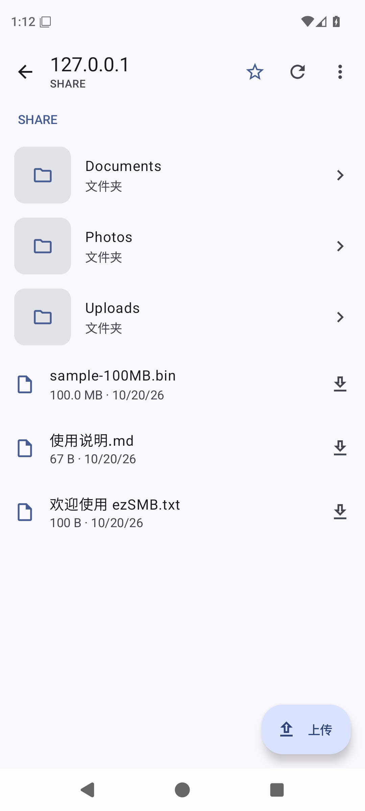
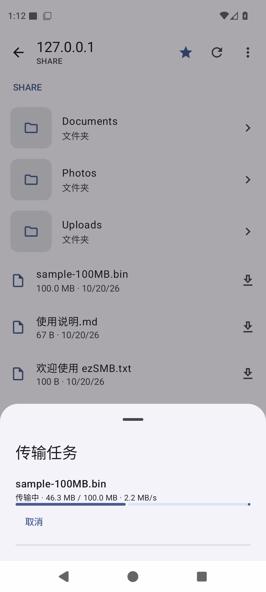
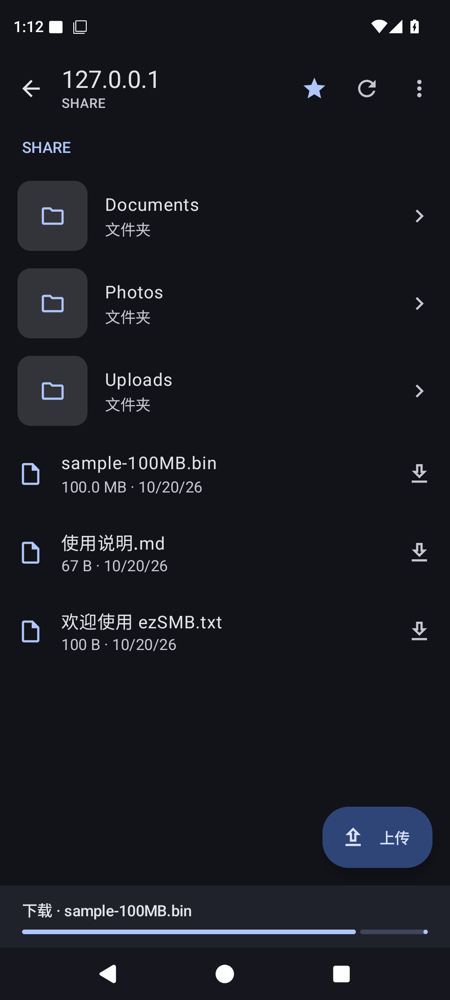

<p align="center">
  
</p>

<h1 align="center">ezSMB</h1>

<p align="center">手机与电脑，轻松传文件。</p>

[官网](https://ezsmb.candlepower.cool/) · [下载 APK](https://github.com/Cand1ePower/ezSMB/releases) · [连接指南](https://ezsmb.candlepower.cool/guide/) · [Privacy](https://ezsmb.candlepower.cool/privacy/)

**Android 原生局域网 SMB 文件工具**。手机直接访问 Windows 共享文件夹、Linux Samba 和 NAS。无需电脑端伴侣程序，无云账户、广告或统计 SDK。


[界面截图](#界面截图) · [功能](#能力) · [开始使用](#开始使用) · [源码构建](#构建) · [English](#english)

## 界面截图

<table>
  <tr>
    <th align="center">文件浏览</th>
    <th align="center">传输任务</th>
    <th align="center">深色模式</th>
  </tr>
  <tr>
    <td><a href="docs/screenshots/files-v0.3.1.png"></a></td>
    <td><a href="docs/screenshots/transfers-v0.3.1.png"></a></td>
    <td><a href="docs/screenshots/files-dark-v0.3.1.png"></a></td>
  </tr>
</table>

## 能力

- 历史设备快速探测、mDNS 和有界 TCP 445 发现；真实 SMB 协商验证，始终支持手动连接。
- SMB2/SMB3 账户认证，Android Keystore 加密记住凭据；探测可用时提供明确的匿名入口。
- 通过 IPC$/SRVSVC 真正枚举服务器共享；服务端限制枚举时手动输入共享名或 SMB 路径。
- 文件夹浏览、逐级系统返回、目录收藏；图片、视频关键帧与文件夹媒体封面预览。
- 下载到 `Download/ezSMB`，通过系统选择器多文件上传，真实进度、队列、取消和从头重试。
- 同名冲突处理、安全临时文件及后台传输通知。动态配色、深色模式和原生 Android 交互。

## 开始使用

1. 电脑开启 SMB 共享，为账户授予文件夹权限；手机与电脑处于可互访的局域网。
2. 在 ezSMB 选择设备，使用电脑账户密码连接。
3. 打开共享文件夹，点文件下载；点「上传」选择手机文件。
4. 下载完成后可打开文件或所在目录。收藏目录后可从首页直达。

请勿启用 SMB1、关闭系统签名或关闭整个防火墙。更多排错见 [Windows / NAS 设置指南](https://ezsmb.candlepower.cool/guide/)。

## 构建

需要 JDK 17+（验证环境使用 21）、Android SDK Platform 36 / Build Tools 35.0.0。Gradle Wrapper 已包含。将 SDK 路径写入未提交的 `local.properties`，或设置 `ANDROID_HOME`。

### Linux

安装 JDK 与 Android SDK 命令行工具，接受 SDK licenses 后安装 `platforms;android-36`、`build-tools;35.0.0`、`platform-tools`：

```sh
chmod +x gradlew
./gradlew testDebugUnitTest lintDebug assembleDebug
adb install -r app/build/outputs/apk/debug/app-debug.apk
```

### Windows

```powershell
.\gradlew.bat testDebugUnitTest lintDebug assembleDebug
# 可选：处理 Windows JDK Unix-domain 临时目录兼容性
.\tools\build.ps1
```

本地 Windows 与 GitHub Ubuntu CI 均已通过构建、单元测试和 lint；EndeavourOS 本机尚未实测。脚本不会修改系统代理、防火墙或共享设置。

## English

**ezSMB** is an MIT-licensed native Android SMB2/SMB3 client for local network file browsing and transfer. Discover computers, enumerate server shares, browse folders, preview images/video frames, bookmark directories, download to Android Downloads and upload using the system document picker. Built with Kotlin, Jetpack Compose and Material You. No ads, analytics or developer cloud file relay.

This is a public preview, not a universal NAS compatibility guarantee. See the verification report for tested environments and limitations. Bug reports and reproducible server/device compatibility results are welcome.
